# Distributed Systems Project

Application distribuée basée sur une architecture micro-services avec Spring Boot et Spring Cloud. La première met en place les services métier (clients et comptes bancaires), le service de découverte et la gateway. La seconde ajoute un agent conversationnel basé sur Spring AI, qui exploite les fonctionnalités des micro-services via le protocole MCP et qui est accessible depuis un client REST, Telegram et Discord.

## Structure du dépôt

```
Distributed-Systems-Project
├── discovery-service    Serveur Eureka
├── customer-service     Gestion des clients
├── ebank-sevice         Gestion des comptes bancaires
├── gateway-service      Spring Cloud Gateway
├── ebank-bot            Agent IA (Spring AI) et serveur/client MCP
└── angular-front        Interface web
```

## Architecture

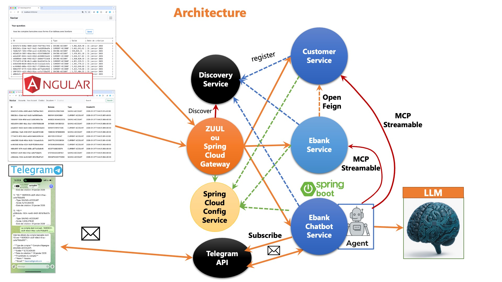

---

# Partie 1 : Micro-services

## Discovery Service

Serveur Eureka démarré sur le port `<8761>` avec l'annotation `@EnableEurekaServer`. Tous les autres services s'y enregistrent.

```yaml
server:
  port: <8761>
eureka:
  client:
    register-with-eureka: false
    fetch-registry: false
```

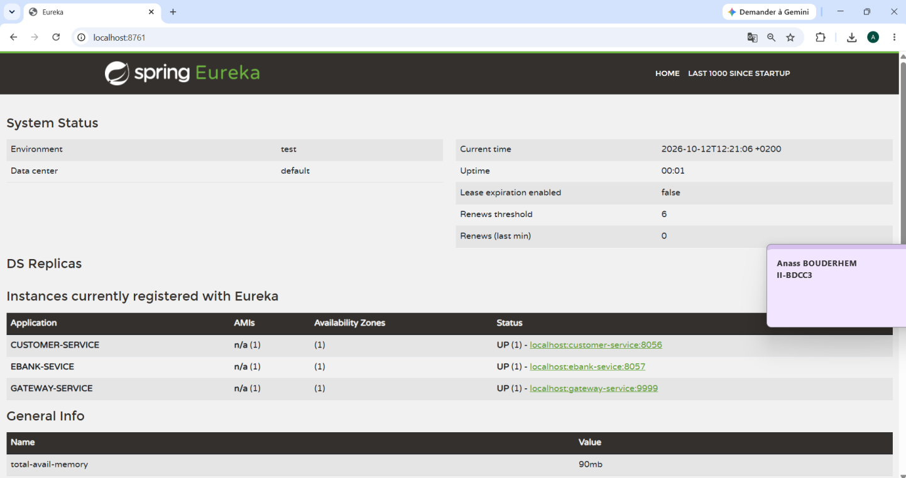

## Customer-Service

Service de gestion des clients (port `<8056>`), avec Spring Data JPA et une base `<H2>`.

| Méthode | Endpoint | Description |
|---|---|---|
| GET | `/customers` | Liste des clients |
| GET | `/customers/{id}` | Consultation d'un client |
| POST | `/customers` | Ajout d'un client |

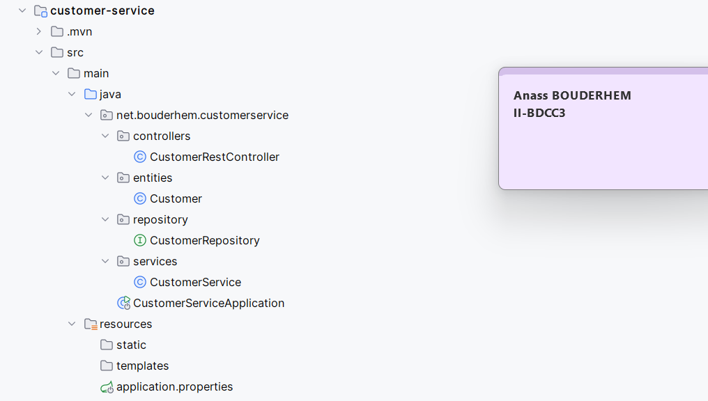

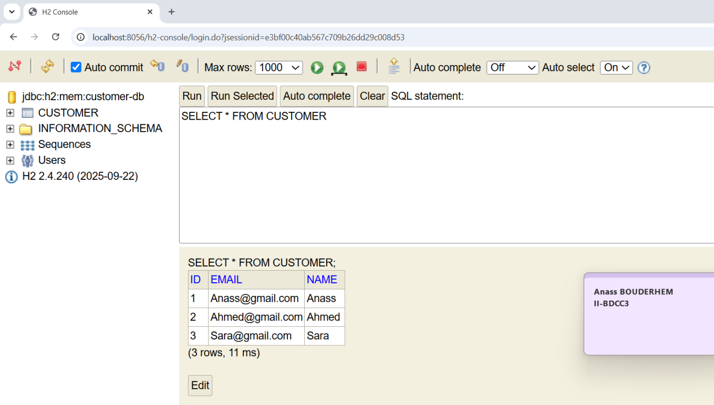

## EBank-Service

Service de gestion des comptes bancaires (port `<8057>`). Chaque compte est rattaché à un client par `customerId`.

| Méthode | Endpoint | Description |
|---|---|---|
| GET | `/accounts` | Liste des comptes |
| GET | `/accounts/{id}` | Consultation d'un compte avec son client |
| POST | `/accounts` | Création d'un compte |

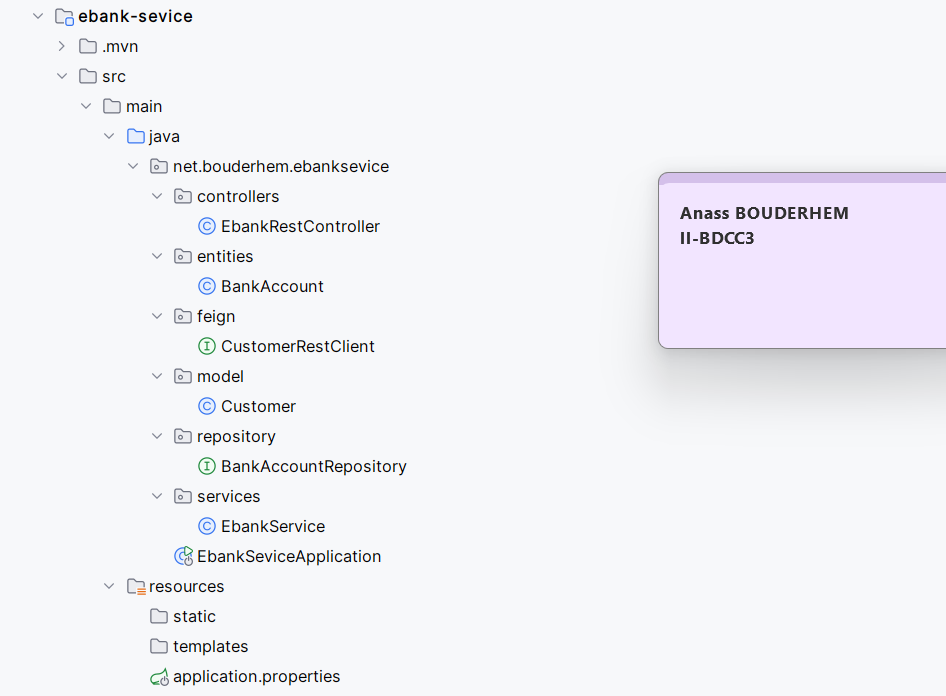

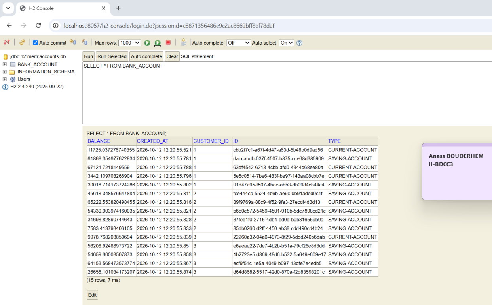

## Communication avec OpenFeign

EBank-Service appelle Customer-Service par son nom Eureka grâce à un client Feign déclaré sous forme d'interface.

```java
@FeignClient(name = "customer-service")
public interface CustomerRestClient {
    @GetMapping("/customers/{id}")
    Customer getCustomerById(@PathVariable Long id);
}
```

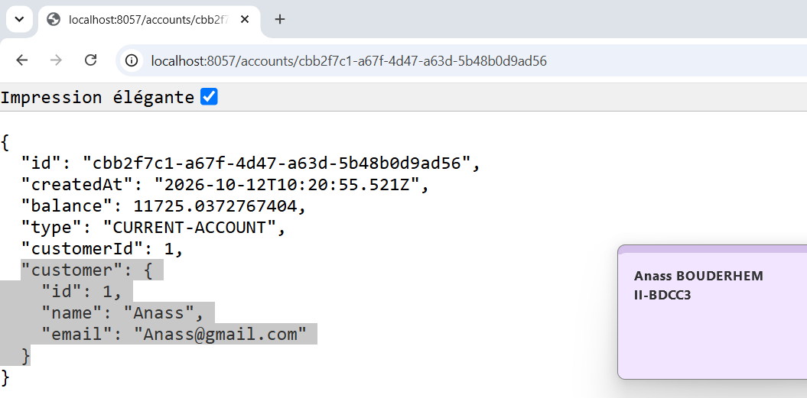

## Tolérance aux pannes avec Resilience4J

L'appel au service client est protégé par un circuit breaker. Lorsque Customer-Service est indisponible, une méthode de repli renvoie une réponse par défaut.

```java
    @CircuitBreaker(name = "customerService", fallbackMethod = "getDefaultCustomer")
```

Cas normal :

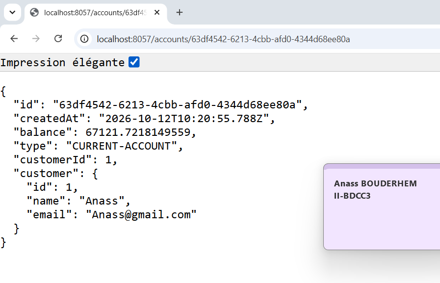

Customer-Service arrêté, la méthode de repli répond :

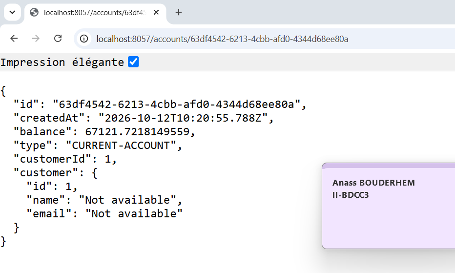

## Gateway

Spring Cloud Gateway sur le port `<9999>`. Elle sert de point d'entrée unique et propose deux modes de routage : statique et dynamique.

### Routage statique

Les routes sont déclarées dans application.yml. Chaque route associe un chemin à un service enregistré dans Eureka (`lb://` délègue le choix de l'instance au load balancer).

```yaml
spring:
  cloud:
    gateway:
      server:
        webflux:
          routes:
            - id : r1
              uri : http://localhost:8056
              predicates:
                - Path= /customers/**
            - id: r2
              uri: http://localhost:8057
              predicates:
                - Path= /accounts/**
```

### Routage dynamique

Avec le locator Eureka, la gateway crée automatiquement une route pour chaque service enregistré, sans déclaration manuelle. Le nom du service sert de préfixe dans l'URL.

Exemple : `http://localhost:9999/CUSTOMER-SERVICE/customers`

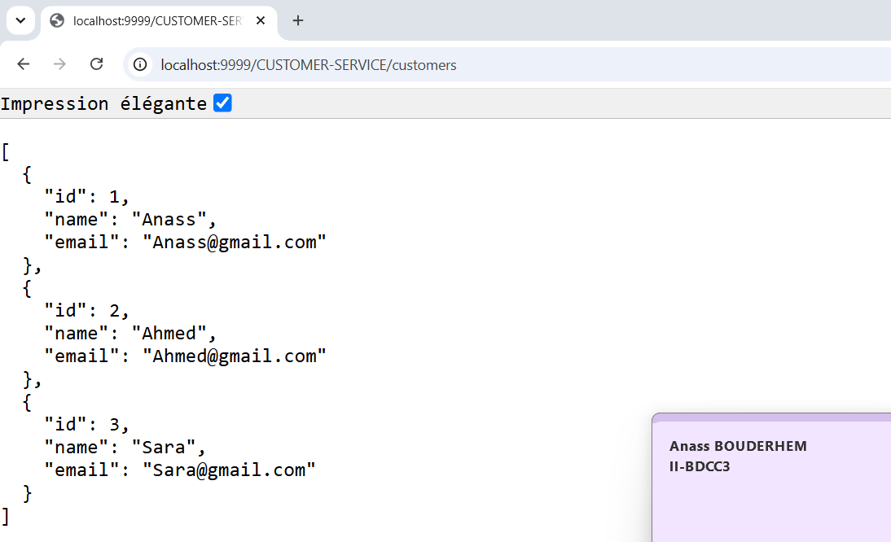
## Tests des services backend

### Postman

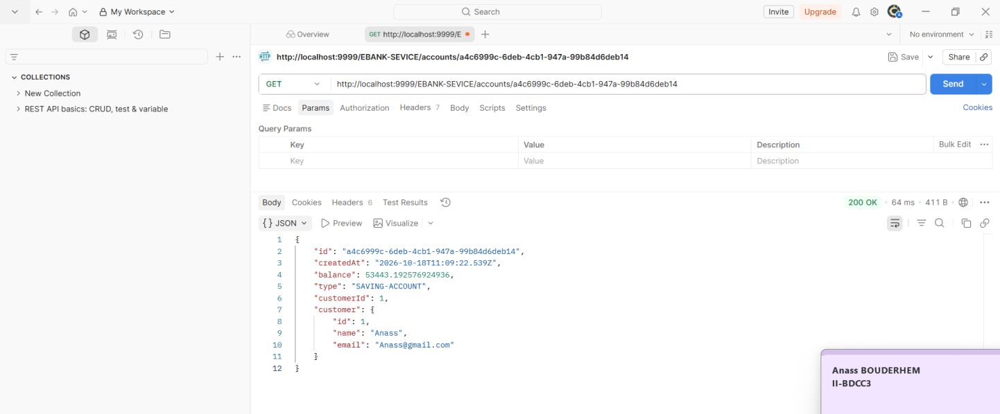

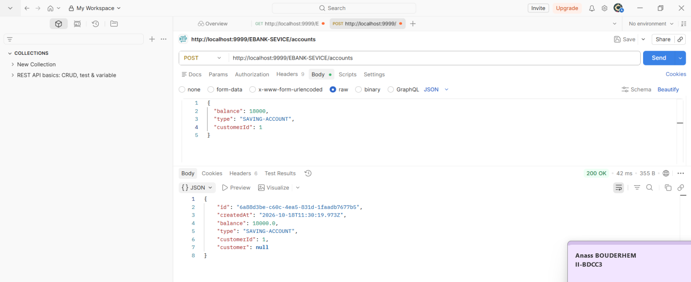


### Swagger-UI

La documentation est générée avec Springdoc OpenAPI et accessible sur `/swagger-ui.html` pour chaque service.

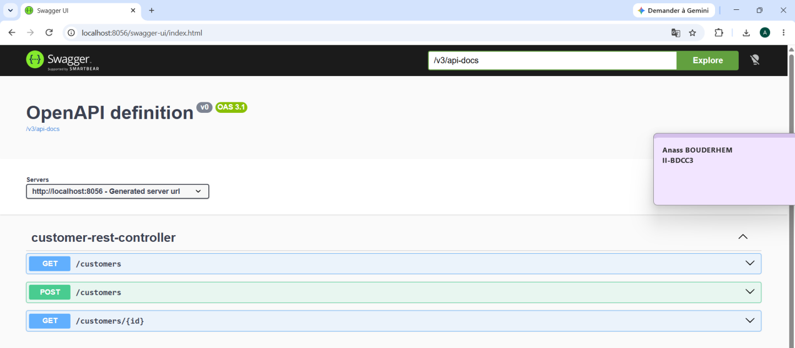

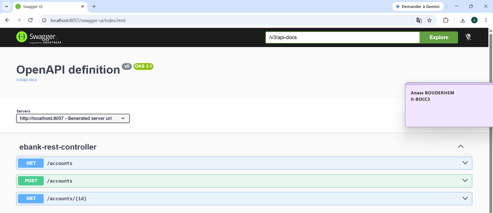


---

# Partie 2 : Agent IA et MCP

## Agent IA avec Spring AI

Le module `ebank-bot` contient l'agent conversationnel. Il utilise Spring AI avec le modèle `gemini-3.8-flash` et conserve l'historique de la conversation.

```yaml
spring.application.name=ebank-bot
spring.ai.google.genai.api-key=${GEMINI_API_KEY}
spring.ai.google.genai.chat.options.model=gemini-3.8-flash
spring.cloud.discovery.enabled=true
spring.cloud.config.enabled=false
server.port=8058
spring.ai.mcp.client.streamable-http.connections.customer.url=http://localhost:8056/mcp
spring.ai.mcp.client.streamable-http.connections.ebank.url=http://localhost:8057/mcp
discord.token=${DISCORD_TOKEN}
telegram.token=${TELEGRAM_TOKEN}
eureka.client.jersey.enabled=false
```

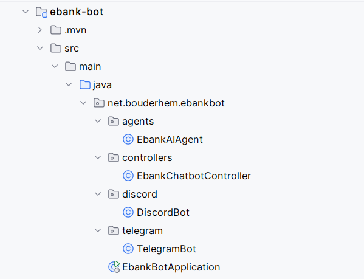

## Exposition des micro-services via MCP

Les fonctionnalités des micro-services sont exposées comme outils MCP. Chaque méthode utile est annotée pour être découverte par le client.

```java
@Tool(description = "<description de l'outil>")
public <Type> <nomDeLaMethode>(...) { ... }
```

## Outils exposés

| Service | Outil | Rôle |
|---|---|---|
| customer-service | `getAllCustomers` | Récupérer tous les clients |
| customer-service | `findCustomerById` | Rechercher un client par son identifiant |
| customer-service | `saveCustomer` | Enregistrer un nouveau client |
| ebank-service | `getAllBankAccounts` | Récupérer tous les comptes bancaires |
| ebank-service | `getBankAccountById` | Récupérer un compte bancaire par son identifiant, avec les informations du client associé |
| ebank-service | `save` | Créer un compte bancaire en vérifiant le client associé |
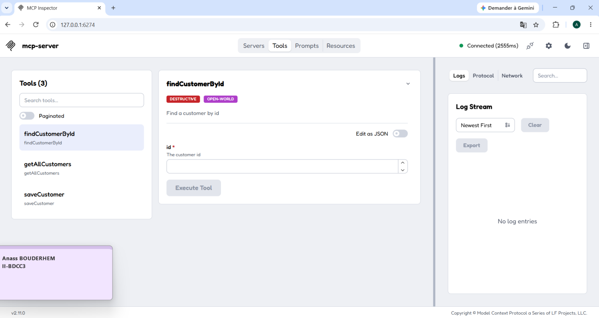
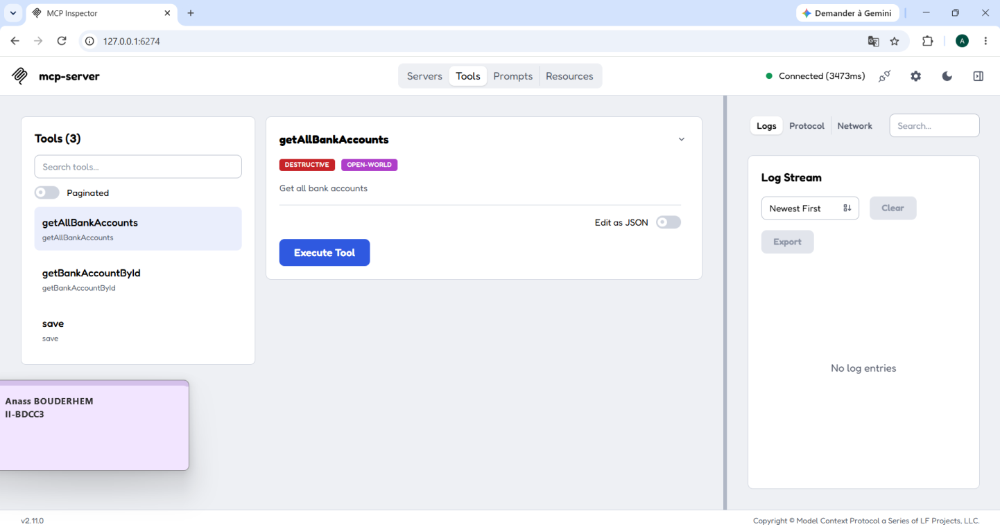


## Test des services via un client MCP

Les outils sont testés avec `MCP Inspector`.

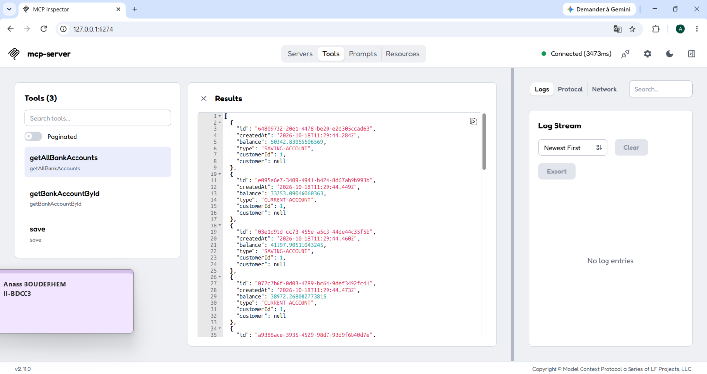

## Test du chatbot

### Client REST

Requête : `GET http://localhost:8058/chat?query=Donnez%20moi%20la%20liste%20des%20comptes%20sous%20forme%20du%20tableau`

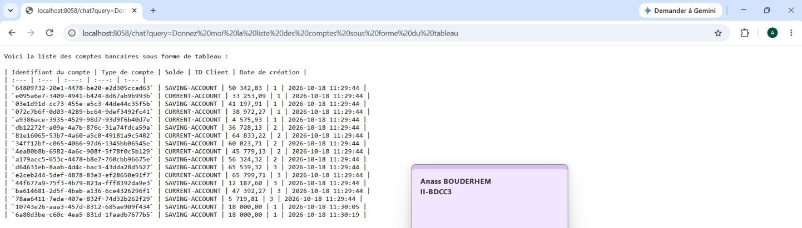

### Telegram

Le chatbot est intégré à Telegram à l'aide de la bibliothèque TelegramBots et du mécanisme **Long Polling**. Les messages reçus sont transmis à l'agent conversationnel `EbankAIAgent`, qui génère une réponse ensuite envoyée à l'utilisateur.

Le bot prend également en charge les messages contenant des images, transmises à l'agent IA pour analyse.

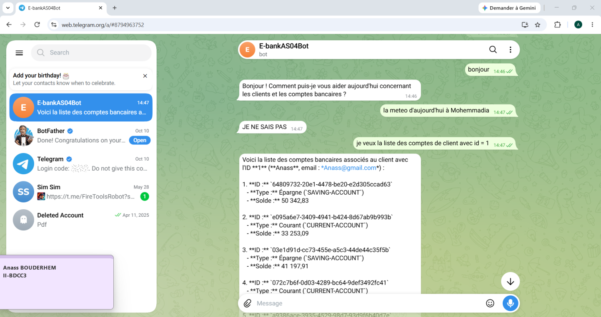

### Discord

Le chatbot est intégré à Discord à l'aide de `spring-boot-starter-discord`. Le composant `DiscordBot` traite les messages reçus, les transmet à l'agent conversationnel `EbankAIAgent` et publie les réponses dans le canal Discord.

Les messages envoyés par des bots sont ignorés afin d'éviter les boucles de réponses.

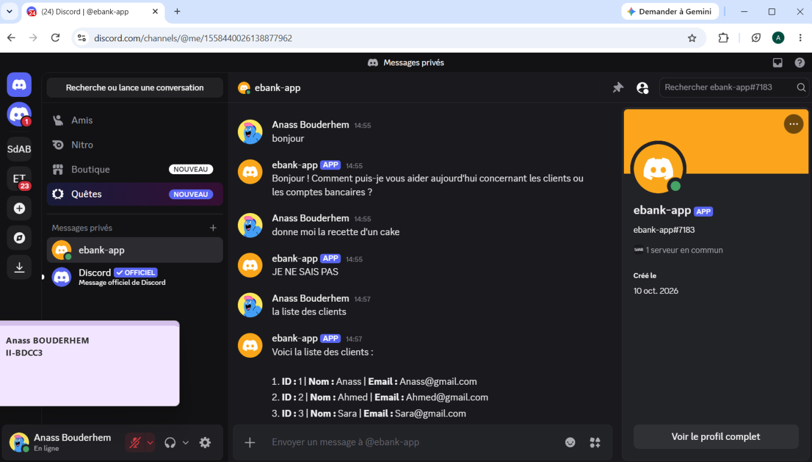

---
